# SalesGenie AI — Project Guide

This is the single Markdown guide for the SalesGenie project. Requirements, API behavior, setup, database notes, milestone evidence, evaluation guidance, and backlogs are consolidated below. Keep future project documentation in this file rather than creating separate Markdown files.

## Contents

- [Project overview](#project-overview)
- [Milestone 3 verification](#milestone-3-verification)
- [Requirements specification](#requirements)
- [API contract](#api-contract)
- [Development setup](#development-setup)
- [Milestone 1 rubric](#milestone-1-rubric)
- [Milestone 1 test report](#milestone-1-test-report)
- [Milestone 2 test report](#milestone-2-test-report)
- [Sprint 1 backlog](#sprint-1-backlog)
- [Sprint 3 backlog](#sprint-3-backlog)
- [Database guide](#database-guide)
- [Database diagram](#database-er-diagram)

<a id="milestone-3-verification"></a>
## Milestone 3 verification — 7 and 13 November 2026

- Automated suite: **38 passed, 1 skipped** (PostgreSQL-only); run with `python -m pytest db\tests -q`.
- Python syntax compilation: `python -m compileall -q api main.py app.py db alembic` passed.
- Latest-prompt local Ollama checks: both fictional sample conversations produced summaries, salient points, and action items.
- Human review of summary quality: requester confirms the review is complete; case-level results and reviewer details were not provided.
- Salesforce and HubSpot live sync tests were confirmed by the requester on 7 November; additional controlled live verification is recorded below.
- Milestone 2 historical scoring accuracy is **76%**, below the 85% target; it remains a documented carryover, not a Milestone 3 result.

### Live verification — 13 November 2026

- `python -m pytest db\tests -q`: **38 passed, 1 skipped**, exit code 0.
- Salesforce and HubSpot credentials were read from the ignored local `.env`; read-only HTTPS authentication checks returned HTTP 200 for both providers. Credential values and CRM record IDs are not recorded here.
- After restarting the API to reload `.env`, `/api/v1/crm/mappings` reported both providers configured. The API health endpoint and Streamlit health endpoint returned HTTP 200.
- A controlled sync of synthetic lead #106 succeeded for both providers. Salesforce updated the contact and sent no activity because its prior successful activity sync was already recorded. HubSpot synchronized the contact and one activity. No deal ID was supplied, so no deal/opportunity stage was updated.
- The configured local `llama3.2:latest` model generated a structured summary, key points, and an action item from a synthetic transcript without persisting the transcript.
- The Streamlit leads page loaded with the API connected and displayed the lead directory without an API error.

## Project overview

Milestone 3 adds conversation intelligence and optional Salesforce/HubSpot sync
to the lead-management, company-analysis, outreach, and scoring workflows.

## Features

- FastAPI endpoints for lead creation, paginated search, retrieval, detail and
  status updates, CSV import, company analysis, saved outreach, activity logging,
  lead scoring, recommendations, conversation summaries, and CRM synchronization.
- Streamlit screens for leads, adding/importing leads, and an Outreach Strategy
  panel for scoring, activity tracking, draft generation, editing, copying, and
  opening a draft in the user's email client; the Conversations screen supports
  transcript summaries, recent activity, and CRM sync status.
- SQLAlchemy models and Alembic migrations for the nine-table project schema.
- SQLite for local development; PostgreSQL 16 parity is supported.
- CSV imports are all-or-nothing: any duplicate or invalid row prevents all
  leads in that file from being created.
- The production score is a transparent rule-based estimate, not a calibrated
  conversion probability. The supplied 500-lead outcome dataset was evaluated
  chronologically: the candidate achieved 76.0% holdout accuracy, below the
  approved 85% target, and is not integrated into production.
- An optional synthetic-only scoring prototype is available via
  `requirements-scoring-prototype.txt` and
  `tools/train_synthetic_scoring_prototype.py`. Its simulated holdout metric is
  not evidence for the 85% milestone target and its model is not used by the app.
- Scoring-data requirements, the evaluation result, and email-review guidance
  are documented in the
  [Milestone 2 test report](#milestone-2-test-report).
- Generated outreach is saved for human review and is never sent automatically.
- Local Ollama summarizes call/meeting transcripts into a saved summary, key
  points, and explicit action items. The transcript itself is not persisted.
- Salesforce Lead/Task and HubSpot Contact/Task mappings support lead/contact,
  activity, and conversation-summary sync. Existing deal stages can be updated
  only when a deal ID and mapping are supplied; the app never creates a deal.
- CRM credentials and organization-specific stage mappings are configured in
  the ignored local `.env`; provider API calls are covered by mocked tests.
- Ollama generation uses domain-specific evidence-grounding instructions,
  low-variance decoding, and schema-constrained JSON for company insights and
  outreach. These improve consistency but do not constitute model-weight
  fine-tuning or guarantee factual accuracy; human review remains required.

Authentication is not implemented. Keep the app local and use synthetic data;
do not expose it publicly or use real prospect data.

## Requirements

- Python 3.10 or newer
- Git
- Ollama with schema-constrained structured-output support for local company
  analysis, outreach, and conversation summarization (no hosted AI API key required)
- Docker Desktop only if you want to run the optional PostgreSQL service

## Run locally on Windows

From the project root in PowerShell:

```powershell
python -m venv .venv
.\.venv\Scripts\Activate.ps1
python -m pip install --upgrade pip
python -m pip install -r requirements.txt
Copy-Item .env.example .env
```

Edit the ignored local `.env` file and set:

```dotenv
DATABASE_URL=sqlite:///./salesgenie.db
OLLAMA_BASE_URL=http://127.0.0.1:11434
OLLAMA_MODEL=llama3.2:latest
API_BASE_URL=http://127.0.0.1:8000
# Optional CRM credentials and status mappings are listed in .env.example.
```

Install and start Ollama for Windows, then download the configured local model:

```powershell
ollama pull llama3.2:latest
```

Ollama serves its local API on `http://127.0.0.1:11434` by default. No AI API key
is needed. Apply the migration and load synthetic sample leads:

```powershell
python -m alembic upgrade head
python -m db.seed
```

Start the API in one terminal:

```powershell
python -m uvicorn main:app --reload --host 127.0.0.1 --port 8000
```

Start the UI in a second terminal:

```powershell
python -m streamlit run app.py --server.address 127.0.0.1 --server.port 8501
```

Open the UI at <http://127.0.0.1:8501> and API documentation at
<http://127.0.0.1:8000/docs>. For PostgreSQL setup and detailed API behavior,
see the project setup and API contract documents in the team's source materials.

## Verification status

The Milestone 2 API, provider, and database tests passed in SQLite. See
[Milestone 2 test report](#milestone-2-test-report) for the current
result and the scoring-accuracy evidence gap. The requester reports that the
Milestone 2 review was completed on 6 November 2026; its decisions and review
records were not provided, so no approval outcome is inferred. The historical
scoring candidate remains below the approved accuracy target and is not used in
production. The requester also reports that the Milestone 1 team evaluation
and walkthrough were completed; supporting case-level review and walkthrough
records are not included here.

The local Ollama `llama3.2:latest` model was exercised with synthetic input. A
temporary-database API/UI end-to-end check generated, displayed, and retrieved
the saved analysis after a page reload without a hosted API key. The requester
confirmed that all team members signed and approved the SRS/API contract; the
individual signature references were not supplied in this workspace. The
requester reports that the team approved the 20-case synthetic dataset and
rubric, that Ollama completed 20/20 operational flows, and that human review
scored 20/20 insights accurate (100%, meeting the >=95% target). The reviewer
worksheet and reviewer identity were not supplied, so this evaluation is
recorded as requester-reported.

Milestone 3 implementation and verification details are in the
[Milestone 3 verification section](#milestone-3-verification). The requester
confirms live Salesforce and HubSpot sync tests are complete; account-specific
test details were not provided. Keep the application local: authentication is
not implemented.

---

<a id="requirements"></a>

## Requirements specification (SRS)

**Status:** Approved per requester confirmation on 24 October 2026; individual approval records are not included in this workspace

**Version:** 0.1

**Prepared:** 15 October 2026

**Source:** Project brief, milestone plan, execution/training guides, and the updated 12–13 October task rows

> The requester confirmed on 24 October 2026 that all team members signed and approved the SRS. Their names and original signature references were not provided here, so this status records the confirmation without reproducing individual signatures.

### 1. Purpose

SalesGenie AI is an AI-assisted sales platform for managing prospects, preparing sales outreach, analyzing leads, summarizing sales conversations, and monitoring sales activity. It is intended to reduce repetitive research and administration while helping sales users prioritize and follow up with prospects.

This SRS records the agreed project scope and provides a basis for API design, implementation, and acceptance testing. Milestone 1 is the first implementation focus; the requirements below describe the full six-module project.

### 2. Project objectives

- Maintain a centralized, searchable lead and prospect database.
- Generate company and lead insights linked to the correct lead.
- Support personalized outreach and lead qualification.
- Summarize sales conversations and capture action items.
- Provide sales-pipeline and activity analytics.
- Expose backend functionality through a documented API and a Streamlit user interface.

### 3. Users and operating context

#### 3.1 User

- **Sales user:** manages prospects, reviews insights, prepares outreach, records or summarizes conversations, and checks sales activity.

#### 3.2 System components

- **User interface:** Streamlit dashboard.
- **API:** Python FastAPI service with Pydantic request/response validation.
- **Persistence:** SQLAlchemy ORM and Alembic migrations; SQLite for local development and PostgreSQL for production, following the selected training-guide baseline.
- **AI service:** Local Ollama API, with the model selected through configuration (`OLLAMA_MODEL`, default `llama3.2:latest`). No hosted AI API key is required.

The application must not be exposed to the public internet with real contact data until authentication, authorization, deployment security, and operational controls are implemented.

### 4. Scope

#### 4.1 Included modules

1. **Lead Management & Prospect Database** — create, import, view, search, update, and track leads.
2. **Lead Intelligence & Company Analysis** — analyze company information and save retrievable insights against a lead.
3. **AI Outreach Generation** — draft personalized emails and sales messages from lead context.
4. **Lead Scoring & Recommendation Engine** — calculate a qualification/likelihood score and suggest next actions.
5. **Conversation Intelligence & CRM Integration** — summarize calls/meetings, extract actions, and support CRM synchronization.
6. **Dashboard & Sales Analytics** — present lead, pipeline, conversion, and outreach activity measures.

#### 4.2 Milestone 1 focus

The first milestone is the lead-to-insight workflow:

1. Create or import a prospect.
2. Retrieve, search, and update the prospect.
3. Analyze company information.
4. Persist the resulting insights against the correct lead.
5. Display the lead and saved insights in the Leads screen.

CSV/manual import, duplicate identification, basic qualification information, test evidence, and a demo path are included in the milestone plan. The sheet's Milestone 1 acceptance target is at least 95% manageable records with accurate insights; evaluation requires an agreed test set and insight-review rubric. The separate 85% scoring-accuracy target belongs to Milestone 2 and is not a substitute for the Milestone 1 target.

#### 4.3 Excluded from the first milestone

- Production-grade authentication, role-based access control, and multi-tenancy.
- Live CRM synchronization or a commitment to a specific CRM vendor.
- Unattended or autonomous outreach delivery.
- A guarantee that generated company facts are accurate without supplied or verifiable sources.
- The Milestone 2 scoring accuracy target and later milestone outcomes.

### 5. Functional requirements

#### 5.1 Lead management

- **FR-LEAD-001:** The system shall create a lead with a company name and optional industry, contact name, email, and phone.
- **FR-LEAD-002:** The system shall assign a unique lead ID and creation/update timestamps.
- **FR-LEAD-003:** The system shall list and retrieve leads, including paginated search/filter results.
- **FR-LEAD-004:** The system shall update lead details and lifecycle status.
- **FR-LEAD-005:** The system shall accept a CSV of leads and report duplicate and invalid rows without silently discarding row errors; the selected Milestone 1 behavior is all-or-nothing, so no rows are imported when any data row is invalid or duplicated.
- **FR-LEAD-006:** The system shall identify likely duplicates using the approved rule: normalized email when present; otherwise normalized company name plus contact name.
- **FR-LEAD-007:** Invalid input and unknown lead IDs shall produce clear, user-visible errors and shall not crash the application.

Approved lifecycle statuses: `New`, `Contacted`, `Qualified`, `Proposal`, `Won`, and `Lost`.

#### 5.2 Company intelligence

- **FR-INTEL-001:** A user shall be able to request company analysis for an existing lead.
- **FR-INTEL-002:** An analysis shall be linked to the lead ID used for the request.
- **FR-INTEL-003:** The system shall save and retrieve analysis results after the request completes.
- **FR-INTEL-004:** An analysis shall return a concise summary, potential needs, opportunities, and a transparent Milestone 1 qualification estimate with its rationale and contributing factors.
- **FR-INTEL-005:** The UI shall show saved analysis alongside the corresponding lead.
- **FR-INTEL-006:** The system shall distinguish model-generated content from verified facts and shall not represent unsupported claims as confirmed facts.

#### 5.3 Outreach generation

- **FR-OUT-001:** A user shall be able to request a draft email or sales message using a lead and selected context.
- **FR-OUT-002:** The system shall return a draft for user review; it shall not send messages automatically in the project scope described here.

#### 5.4 Lead scoring and recommendations

- **FR-SCORE-001:** The system shall produce a lead score and explain the principal factors used.
- **FR-SCORE-002:** The system shall provide a next-best-action recommendation when sufficient lead/activity data is available.
- **FR-SCORE-003:** Scores shall be labeled as estimates, not guarantees of conversion.

#### 5.5 Conversation intelligence and CRM integration

- **FR-CONV-001:** A user shall be able to submit a call/meeting transcript for summarization.
- **FR-CONV-002:** The system shall return a summary, key points, and action items.
- **FR-CONV-003:** The system shall persist summaries against the selected lead without retaining the submitted transcript.
- **FR-CRM-001:** The system shall synchronize lead/contact fields and recorded activities with Salesforce and HubSpot through documented field mappings.
- **FR-CRM-002:** The system shall record each CRM synchronization result, external record ID, and safe error code without storing credentials or full CRM payloads.
- **FR-CRM-003:** The system shall update an existing CRM deal/opportunity stage only when the caller provides its ID and a status-to-stage mapping is configured; it shall not create a deal/opportunity.

#### 5.6 Dashboard and analytics

- **FR-DASH-001:** The dashboard shall show total leads and lead counts by lifecycle status.
- **FR-DASH-002:** As relevant data becomes available, the dashboard shall show pipeline, conversion, and outreach activity measures.
- **FR-DASH-003:** Analytics shall be derived from persisted application data and shall not fabricate unavailable measures.

### 6. Data requirements

The initial logical data model is:

| Entity | Purpose | Key relationships |
|---|---|---|
| Lead | Company/contact details and lifecycle status | One lead may have many insights, scores, outreach drafts, activities, conversation summaries, and CRM sync logs |
| CompanyInsight | Persisted company analysis and qualification information | Belongs to one lead |
| LeadScore | Score, rationale, and scoring timestamp | Belongs to one lead |
| OutreachDraft | Generated message, type, and creation timestamp | Belongs to one lead |
| Activity | Lead engagement history and event details | Belongs to one lead |
| ConversationSummary | Summary, key points, and action items | Belongs to one lead when the conversation is associated with a lead |
| CrmSyncLog | Provider/entity sync outcome, remote ID, safe error code, timestamp | May reference a lead; retained with null lead reference after lead deletion |
| ImportBatch | CSV import counts and row-level validation errors | Tracks one import request; imported leads remain in Lead |
| AgentRun | Workflow name, status, timing, and safe error/checkpoint metadata | May reference a lead; does not store prompts, credentials, or full agent state |

The implemented database schema contains nine tables: the six business entities above, `ImportBatch`, `AgentRun`, and `CrmSyncLog` operational metadata. Conversation summaries retain interaction type, summary, key points, and action items, but not the source transcript. CRM logs retain provider, entity, internal record reference, outcome, external ID, safe error code, and timestamp. The team must still review column types, nullability, indexes, and migration strategy before production use. The initial lead fields are `lead_id`, `company_name`, `industry`, `contact_name`, `email`, `phone`, `lead_status`, `created_at`, and `updated_at`.

### 7. Non-functional requirements

- **NFR-REL-001:** At least 95% of the agreed Milestone 1 prospect test set shall be manageable through the supported create/import, retrieve, and update workflow, and generated insights shall meet the team's agreed accuracy rubric. The test report shall record the test-set definition, numerator, denominator, rubric, reviewer outcome, and failures. Deterministic test-provider results do not establish real insight accuracy.
- **NFR-REL-002:** Missing IDs, invalid records, duplicate imports, and provider/database failures shall produce explicit errors; they shall not be reported as successful operations.
- **NFR-SEC-001:** API keys and populated environment files shall remain outside version control. Use a documented `.env.example` containing placeholders only.
- **NFR-SEC-002:** Demo and test runs shall use synthetic or approved sample records, not personal or confidential customer data.
- **NFR-SEC-003:** Local services shall bind to localhost by default. Production exposure requires a separately reviewed security design.
- **NFR-SEC-004:** CRM credentials shall be read from local environment configuration, never returned by APIs or persisted in sync logs; transcripts shall not be stored.
- **NFR-DATA-001:** A successful analysis shall persist with a valid lead foreign key and be retrievable after the request.
- **NFR-USE-001:** The user shall be able to complete the demo flow: Add Lead → retrieve lead → Analyze Company → view saved insights.
- **NFR-PERF-001:** The project brief's under-five-second analysis/outreach target is a later evaluation goal; it must be measured and reported under representative conditions before being claimed.
- **NFR-REL-003:** Milestone 2 lead-scoring validation shall meet at least 85% accuracy on an agreed, labeled test set using a documented scoring rubric. The score must not be presented as a calibrated conversion probability unless validated against representative historical outcomes.
- **NFR-MAINT-001:** API request/response shapes and shared data fields shall be documented and agreed by backend and database owners before cross-module implementation.

### 8. Milestone 1 acceptance criteria

Milestone 1 is acceptable when:

1. The agreed test set and results are recorded; at least 95% meet the agreed manageable-record criterion, and generated insights meet the agreed human-review accuracy rubric.
2. Invalid rows and duplicate imports are reported clearly.
3. Analysis is linked to the correct lead, persists, and can be retrieved.
4. All team members can follow the agreed local setup instructions.
5. The team can demonstrate the complete lead-to-saved-insight flow using approved sample data.
6. Open critical defects, their owners, and their disposition are included in the test/sign-off report.

**Reported outcome (24 October 2026):** The requester reports team approval of
the evaluation set/rubric, a 20/20 manageable-record result, a 20/20 human
insight-accuracy result, and completion of the team walkthrough. The
case-level review worksheet and walkthrough details were not supplied.

#### Milestone 2 scope and acceptance

The project schedule assigns Milestone 2 to Module 3 (AI Outreach Generation)
and Module 4 (Lead Scoring & Recommendation Engine). The application shall:

1. Generate email or message drafts with selectable tone, length, goal, and
   user-supplied pain points; save drafts against the selected lead.
2. Let a user regenerate, edit, copy/download, and open email drafts in their
   local email client for review. The application does not send messages.
3. Calculate a transparent 0–100 sales-readiness estimate from fit, recorded
   engagement, intent signals, and decision readiness; persist it with its
   factors and a next-best-action recommendation.
4. Allow sales activities to be recorded so engagement-based scoring uses
   persisted data.
5. Demonstrate scoring at or above 85% accuracy on the team-approved labeled
   evaluation set, and test personalized outreach across multiple industries.

The current implementation uses an explainable rule-based baseline. No
Milestone 2 labeled outcomes, scoring rubric, or case-level expected labels
were available in the shared project materials during implementation; therefore
the 85% accuracy criterion remains unverified and is not claimed as met.

#### Milestone 3 scope and acceptance

Milestone 3 covers conversation intelligence and CRM integration:

1. A sales user submits a call or meeting transcript and receives a concise,
   evidence-grounded summary, key discussion points, and explicitly stated
   action items.
2. The summary is persisted against its lead and remains retrievable; the raw
   transcript is not persisted.
3. Contacts, recorded activities, and conversation summaries can be
   synchronized to configured Salesforce or HubSpot accounts. Field/status
   mappings are configurable, and synchronization attempts are visible in
   `crm_sync_logs`.
4. An existing opportunity/deal stage can be updated only when an external ID
   and a matching stage mapping are explicitly supplied/configured. The system
   does not create opportunities or deals.
5. The Streamlit Conversations screen supports transcript summarization,
   recent activity review, CRM connection status, sync results, and sync-log
   review.
6. Automated tests cover provider success/failure paths, persistence,
   idempotent activity sync, mapping requirements, and migration upgrade and
   downgrade. Requester confirms live Salesforce and HubSpot sync tests are
   complete; provider-side details were not supplied in this workspace.

### 9. Assumptions and decisions requiring team confirmation

| Decision | Current baseline | Confirmation needed |
|---|---|---|
| Core stack | Python, FastAPI, Streamlit, Pydantic, SQLAlchemy, Alembic | Approved per requester confirmation; dependency ranges are in `requirements.txt` |
| Database | SQLite for local development; PostgreSQL for production | Approved per requester confirmation; PostgreSQL 16 migration/API parity was verified previously |
| AI provider/model | Local Ollama API; default model `llama3.2:latest` | Approved per requester confirmation; local model and saved-analysis UI flow verified with synthetic data |
| Lead status values | New, Contacted, Qualified, Proposal, Won, Lost | Approved per requester confirmation |
| Duplicate rule | Normalized email; otherwise company + contact | Approved per requester confirmation |
| Milestone 1 accuracy acceptance | Sheet requires >=95% manageable records and accurate insights | Requester reports team approval of the 20-case synthetic set and rubric, 20/20 manageable Ollama flows, and 20/20 outputs judged accurate by human review (100%, >=95% target met). Per-case review notes and reviewer identity were not supplied. |
| CRM integration | Salesforce and HubSpot adapters; SalesGenie lifecycle status maps to CRM Lead/Contact status fields | Selected by requester for Milestone 3; credentials are local environment settings. Existing deals are updated only with an explicit deal ID and configured stage map; no deals are created. |
| Authentication | Excluded from initial local milestone | Required before production deployment |
| Repository | `https://github.com/infosys-springboard-team-d/sales-genie-ai.git`; Milestone 1 is published on `main` | Workspace is not a Git checkout; publication/review remains separate |

### 10. Review and sign-off

The requester confirmed on 24 October 2026 that all team members signed and approved the scope and requirements. Individual names and signature references were not supplied, so the table records the reported approval only; it does not reproduce signatures. Approval does not claim that every implementation acceptance metric has been demonstrated.

| Role | Name | Decision | Date | Approval reference |
|---|---|---|---|---|
| Project Lead | Not provided | Approved per requester confirmation | 24 October 2026 | Individual signature reference not provided |
| Backend Developer | Not provided | Approved per requester confirmation | 24 October 2026 | Individual signature reference not provided |
| Database/DevOps Engineer | Not provided | Approved per requester confirmation | 24 October 2026 | Individual signature reference not provided |
| Full Team representative(s) | Not provided | Approved per requester confirmation | 24 October 2026 | Individual signature reference not provided |

### 11. Reference material

The project brief, milestone schedule, execution guide, training guides, and
installation guide were supplied separately. They are not included in this
source-and-Markdown-only repository update.

---

<a id="api-contract"></a>

## API contract

**Status:** Milestones 1–2 API contract as previously reviewed; Milestone 3 endpoints documented 7 November 2026. Salesforce and HubSpot selected by requester; live account verification requires credentials.

**Version:** 0.1

**Prepared:** 15 October 2026

**Base path:** `/api/v1`
**Related specification:** [Requirements section](#requirements)

> The requester confirmed that all team members signed and approved the API contract. Individual names and signature references were not supplied here. The API is intended for local development; it must not be publicly exposed with real lead data before an authentication/security design is implemented and reviewed.

### 1. Conventions

- JSON request and response bodies use `application/json`, except CSV upload.
- Identifiers are integer `lead_id` values.
- Timestamps are ISO 8601 UTC strings.
- Unknown fields and invalid values return a validation error; they are not silently ignored.
- List endpoints return stable pagination metadata.
- Errors use the common envelope below.

#### 1.1 Error response

```json
{
  "error": {
    "code": "VALIDATION_ERROR",
    "message": "The request contains invalid fields.",
    "details": [
      {"field": "email", "message": "Must be a valid email address."}
    ]
  }
}
```

`details` may be an empty array when there are no field-specific details. Do not return secrets, provider credentials, stack traces, or internal database details.

### 2. Lead schema

```json
{
  "lead_id": 123,
  "company_name": "Example Systems",
  "industry": "Software",
  "contact_name": "Jordan Lee",
  "email": "jordan@example.com",
  "phone": "+1-555-0100",
  "lead_status": "New",
  "created_at": "2026-10-15T12:00:00Z",
  "updated_at": "2026-10-15T12:00:00Z"
}
```

`company_name` is required. Other contact/company fields are optional and nullable. The server owns `lead_id`, `created_at`, and `updated_at`; clients must not set them. Blank optional text fields are normalized to null.

Implemented draft `lead_status` values: `New`, `Contacted`, `Qualified`, `Proposal`, `Won`, and `Lost`. Backend and database owners must confirm these values before production use.

### 3. Milestone 1 endpoints

#### 3.1 Create lead

`POST /api/v1/leads`

Request:

```json
{
  "company_name": "Example Systems",
  "industry": "Software",
  "contact_name": "Jordan Lee",
  "email": "jordan@example.com",
  "phone": "+1-555-0100"
}
```

Response: `201 Created`, body is the created Lead schema.

Errors: `400` validation failure; `409` duplicate detected using the current draft rule.

#### 3.2 List, search, and filter leads

`GET /api/v1/leads`

Query parameters:

| Name | Type | Default | Meaning |
|---|---|---:|---|
| `q` | string | none | Case-insensitive search over company, contact, email, and industry |
| `status` | string | none | Filter by an allowed lifecycle status |
| `page` | integer ≥ 1 | `1` | Page number |
| `page_size` | integer 1–100 | `20` | Maximum records in the page |

Response: `200 OK`.

```json
{
  "items": [],
  "page": 1,
  "page_size": 20,
  "total": 0
}
```

#### 3.3 Retrieve lead

`GET /api/v1/leads/{lead_id}`

Response: `200 OK`, body is the Lead schema. Unknown ID: `404 Not Found`.

#### 3.4 Update lead

`PATCH /api/v1/leads/{lead_id}`

Request contains one or more editable fields from `company_name`, `industry`, `contact_name`, `email`, and `phone`. `lead_id`, timestamps, and `lead_status` are not editable through this endpoint.

Response: `200 OK`, body is the updated Lead schema. Unknown ID: `404`; invalid fields: `400`.

#### 3.5 Update lifecycle status

`PATCH /api/v1/leads/{lead_id}/status`

Request:

```json
{"lead_status": "Qualified"}
```

Response: `200 OK`, body is the updated Lead schema. Unknown ID: `404`; unsupported status: `400`.

#### 3.6 Import CSV

`POST /api/v1/leads/import`

Content type: `multipart/form-data`; field name: `file`. CSV header names: `company_name`, `industry`, `contact_name`, `email`, `phone`, `lead_status`. `company_name` is required; if `lead_status` is omitted, it defaults to `New`.

Uploads must be UTF-8 CSV, at most 5 MiB and 10,000 data rows, with unique supported headers.

Import is all-or-nothing. If any row is invalid or duplicated, none of the valid rows in that file are created. The batch result is still persisted with status `failed` and its duplicate/invalid counts.

Response: `200 OK`.

```json
{
  "created": 2,
  "duplicates": 0,
  "rejected": 0,
  "committed": true,
  "duplicate_rows": [],
  "rolled_back_rows": [],
  "row_errors": []
}
```

When the file is rejected, `created` is always zero and `committed` is false. `duplicate_rows` and `rolled_back_rows` contain CSV row numbers (header is row 1); `row_errors` gives duplicate/invalid row details. Valid rows rolled back due to another row's error are not classified as created or rejected. Therefore, `created + duplicates + rejected + len(rolled_back_rows)` equals the nonblank data-row count. `committed` is true only when all nonblank rows passed and were committed.

The approved duplicate rule is normalized email when present, otherwise normalized company name plus contact name. For a no-email incoming row, the fallback check also finds a matching existing lead with an email. For rows within the same CSV, email comparisons use the normalized email; no-email rows use the normalized company/contact pair.

#### 3.7 Analyze a lead's company

`POST /api/v1/leads/{lead_id}/analysis`

Request:

```json
{
  "context": "Optional user-supplied company or industry notes."
}
```

`context` is optional. The first milestone uses saved lead fields and supplied context; live web research is not promised by this contract.

Response: `201 Created`.

```json
{
  "analysis_id": 456,
  "lead_id": 123,
  "summary": "Concise generated summary.",
  "potential_needs": ["Example need"],
  "opportunities": ["Example opportunity"],
  "qualification": {
    "score": 80,
    "rationale": "Estimated qualification score based on available lead details and analysis signals; not a predicted conversion probability.",
    "factors": {
      "industry_provided": 15,
      "contact_identified": 15,
      "email_available": 15,
      "phone_available": 10,
      "analysis_summary_available": 10,
      "potential_needs_identified": 15,
      "opportunities_identified": 0
    }
  },
  "created_at": "2026-10-15T12:05:00Z"
}
```

The analysis must be persisted and linked to the requested lead. `qualification.score` is an integer from 0 to 100. Milestone 1 uses an explainable completeness/analysis-signal heuristic; the rationale and factor contributions are returned and persisted. This is not a predicted conversion probability. The requester reports team approval of the 20-case synthetic evaluation set and rubric, 20/20 manageable Ollama flows, and a human accuracy score of 20/20 (100%, meeting the >=95% target). Reviewer identity and per-case review notes were not supplied; see [Milestone 1 test report](#milestone-1-test-report) for evidence qualifications.

Errors: `404` unknown lead; `422` invalid request; `502` local AI provider unavailable or invalid response; `503` missing provider configuration or database unavailability. Provider failures must be explicit and must not create a success-shaped analysis record. The API uses the local Ollama server at `OLLAMA_BASE_URL` and the model configured by `OLLAMA_MODEL` (default `llama3.2:latest`); no hosted AI API key is required.

#### 3.8 Retrieve the latest saved analysis

`GET /api/v1/leads/{lead_id}/analysis`

Response: `200 OK`, body is the latest analysis schema. Unknown lead: `404`; no analysis exists: `404` with code `ANALYSIS_NOT_FOUND`.

### 4. Milestone 2 endpoints

#### 4.1 Generate and save an outreach draft

`POST /api/v1/leads/{lead_id}/outreach-drafts`

Request:

```json
{
  "draft_type": "email",
  "tone": "professional",
  "length": "medium",
  "goal": "Start a relevant sales conversation",
  "pain_points": ["Manual reporting"]
}
```

`draft_type` is `email` or `message`; `tone` is `professional`, `friendly`,
`concise`, or `persuasive`; `length` is `short`, `medium`, or `long`. The goal
is required and at most 500 characters. There may be up to 10 user-supplied
pain points, each at most 500 characters. When no verified pain points are
supplied, the provider uses a neutral template rather than asking the model to
infer a prospect need. Provider output is stored as a draft linked to the
requested lead:

```json
{
  "draft_id": 25,
  "lead_id": 123,
  "draft_type": "email",
  "content": "Subject: A reporting idea\n\nHello Jordan, ...",
  "created_at": "2026-10-29T12:05:00Z"
}
```

The content is generated for human review and is never sent by the API.
Provider errors return the common error envelope (`502 AI_PROVIDER_ERROR` or
`503 AI_PROVIDER_NOT_CONFIGURED`) and do not save a draft. Unknown lead: `404`.

#### 4.2 List and edit saved outreach drafts

- `GET /api/v1/leads/{lead_id}/outreach-drafts` returns up to 100 drafts, newest first; an empty list means no draft has been saved.
- `PATCH /api/v1/outreach-drafts/{draft_id}` accepts `{"content":"..."}` to save user edits. Blank content is invalid; unknown draft: `404`.

The UI can open an email draft in the user's local email client through a
`mailto:` link. The user must review recipient and content and choose whether
to send it. There is no email-delivery integration.

#### 4.3 Calculate and retrieve a lead score

- `POST /api/v1/leads/{lead_id}/scores` calculates and saves a 0–100 estimate and recommendation.
- `GET /api/v1/leads/{lead_id}/scores/latest` returns the latest Milestone 2 score; no saved score: `404 SCORE_NOT_FOUND`.

The response contains `score`, a `low`/`moderate`/`high` score label, the
factor contributions (`fit`, `engagement`, `intent`, `decision_readiness`),
the rationale, and a persisted recommendation (`action`, `timing`, `channel`,
and `rationale`). The current score is a transparent rule-based estimate, not
a calibrated conversion probability. The workbook's 85% accuracy target
requires an agreed labeled evaluation set; no such set or rubric is currently
available, so the target has not been validated.

The current provisional weights total 100 points: fit (0–25) awards points for
industry and an analyzed opportunity; engagement (0–25) uses activities
recorded in the previous 30 days and lifecycle contact status; intent (0–25)
uses analyzed needs/opportunities and saved conversation summaries; decision
readiness (0–25) uses contact completeness and lifecycle stage. Labels are
`low` below 40, `moderate` from 40 through 69, and `high` at 70 or above.
These weights and thresholds require team review against the scoring rubric
before the 85% accuracy target can be assessed.

#### 4.4 Record and list lead activities

- `POST /api/v1/leads/{lead_id}/activities` accepts an `activity_type` of `call`, `email`, `meeting`, `reply`, or `note`, with optional details (at most 2,000 characters).
- `GET /api/v1/leads/{lead_id}/activities` returns up to 100 activities, newest first.

Activity entries are user-recorded; generating or opening an outreach draft
does not imply it was sent or count as engagement.

### 5. Milestone 3 endpoints

#### 5.1 Summarize and save a call or meeting

`POST /api/v1/leads/{lead_id}/conversation-summaries`

Request:

```json
{
  "interaction_type": "meeting",
  "transcript": "The participants discussed the reporting workflow..."
}
```

`interaction_type` is `call` or `meeting` (default `call`). `transcript` is
required, nonblank, and at most 40,000 characters. The configured local Ollama
provider treats transcript text as data, and returns a factual summary, key
discussion points, and explicitly stated action items. Provider failure returns
the common error envelope (`502 AI_PROVIDER_ERROR` or
`503 AI_PROVIDER_NOT_CONFIGURED`) and does not persist a summary.

Response: `201 Created`.

```json
{
  "summary_id": 41,
  "lead_id": 123,
  "interaction_type": "meeting",
  "summary": "The prospect asked for an overview of the reporting workflow.",
  "key_points": ["Reporting workflow is a current discussion topic."],
  "action_items": ["Sales owner to send the requested overview; due date unspecified."],
  "created_at": "2026-11-07T12:05:00Z"
}
```

Only the summary, key points, action items, interaction type, lead ID, and
timestamp are persisted; the submitted transcript is not retained. The API
does not claim that model-generated summaries are independently verified.
Unknown lead: `404`.

`GET /api/v1/leads/{lead_id}/conversation-summaries` returns up to 100 saved
summaries, newest first. An empty list means no summary is saved.

#### 5.2 CRM mappings and sync

- `GET /api/v1/crm/mappings` reports whether each provider is configured and
  its non-secret contact, activity, lifecycle-status, and deal-stage mappings.
- `POST /api/v1/leads/{lead_id}/crm-sync` synchronizes the lead/contact and,
  when requested, up to 100 unsynchronized activities and conversation
  summaries.
- `GET /api/v1/leads/{lead_id}/crm-sync-logs` returns the latest 100 sync log
  records for the lead.

Request:

```json
{
  "provider": "hubspot",
  "include_activities": true,
  "deal_id": "existing-deal-id"
}
```

`provider` is `salesforce` or `hubspot`. `include_activities` defaults to
`true`. `deal_id` is optional and identifies an existing CRM opportunity/deal;
no deal is created. If `deal_id` is supplied, the current SalesGenie lifecycle
status must have a configured CRM stage mapping or the API returns
`400 CRM_STAGE_MAPPING_NOT_CONFIGURED` before any external write.

Salesforce uses the CRM `Lead` and `Task` objects; HubSpot uses `Contact` and
`Task` objects. Status fields map to Salesforce `Status` and HubSpot
`lifecyclestage`. A provided deal ID can update Salesforce `Opportunity.StageName`
or HubSpot `dealstage` only when its stage mapping exists. Salesforce and
HubSpot field values must exist in the target account. For Salesforce, a
contact name is required because the `Lead` object requires `LastName`.

A sync response has status `succeeded` or `partial`; it includes one operation
result per attempted contact, activity, and deal-stage update. Successful
activity syncs are not repeated on subsequent calls. Failures are recorded with
safe error codes and can be retried; remote writes already accepted by a CRM
cannot be rolled back if a later operation fails. Missing credentials return
`503 CRM_PROVIDER_NOT_CONFIGURED` and are recorded. Provider API failures
return `502` for contact sync; activity/stage failures are reported in the
response as `partial` and in the sync log.

Credentials and mapping overrides belong only in the ignored local `.env`:

| Variable | Purpose |
|---|---|
| `SALESFORCE_INSTANCE_URL`, `SALESFORCE_ACCESS_TOKEN` | Salesforce org URL and short-lived OAuth access token |
| `SALESFORCE_API_VERSION` | REST API version (default `v61.0`) |
| `SALESFORCE_STATUS_MAPPING` | JSON mapping from SalesGenie statuses to org-specific Lead Status values |
| `SALESFORCE_DEAL_STAGE_MAPPING` | JSON mapping from SalesGenie statuses to existing Salesforce Opportunity stages |
| `HUBSPOT_ACCESS_TOKEN` | HubSpot private-app access token |
| `HUBSPOT_LIFECYCLE_STAGE_MAPPING` | JSON mapping from SalesGenie statuses to HubSpot lifecycle-stage values |
| `HUBSPOT_DEAL_STAGE_MAPPING` | JSON mapping from SalesGenie statuses to existing HubSpot deal-stage IDs |

Never commit tokens. Use only approved synthetic/sample CRM data for tests.
Authentication is not implemented in this application; keep it bound to
localhost and do not expose it publicly.

#### 5.3 Later endpoint proposal

| Module | Proposed endpoint | Milestone |
|---|---|---|
| Conversation summary | `POST /api/v1/leads/{lead_id}/conversation-summaries` | 3 |
| CRM integration | Vendor-specific integration routes to be agreed | 3 |
| Dashboard analytics | `GET /api/v1/analytics/summary` | 4 |

### 6. Proposed persistence mapping

The nine-table schema keeps the six domain resources below and adds import-batch,
agent-run, and CRM-sync operational metadata. The database implementation and migration
are in the workspace `db/` and `alembic/` directories. The requester confirms
team approval of this contract and the selected status and duplicate policies.

| Resource | Table | Important fields |
|---|---|---|
| Lead | `leads` | `lead_id`, company/contact fields, `lead_status`, timestamps |
| Analysis | `company_insights` | `analysis_id`, `lead_id` foreign key, result fields, `created_at` |
| Score | `lead_scores` | `score_id`, `lead_id` foreign key, score, rationale, timestamp |
| Outreach draft | `outreach_drafts` | draft ID, `lead_id` foreign key, type, content, timestamp |
| Activity | `activities` | activity ID, `lead_id` foreign key, type, details, timestamp |
| Conversation summary | `conversation_summaries` | summary ID, optional `lead_id` foreign key, summary, key points, actions, timestamp |
| CSV import batch | `import_batches` | Batch ID, status, created/duplicate/rejected counts, row errors, timestamps |
| Agent workflow run | `agent_runs` | Run ID, optional `lead_id`, workflow/status/timing, checkpoint reference, safe error code |
| CRM sync log | `crm_sync_logs` | Optional `lead_id`, provider, entity, internal record reference, status, external ID, safe error code, timestamp |

Use database migrations for schema changes. The precise JSON/list storage representation must be tested against both the selected SQLite development configuration and PostgreSQL production configuration.

### 7. Shared decisions to close before coding

1. Approve lifecycle values and duplicate matching rule.
2. Confirm CSV UTF-8 encoding and maximum file/row limits.
3. Approve the transparent estimated qualification rubric (not a conversion prediction).
4. Approve the local Ollama model and provider timeout/retry policy.
5. Approve lead/analysis response types with the Streamlit consumer.
6. Review the FastAPI-generated OpenAPI document at `/openapi.json` whenever endpoint behavior changes.

---

<a id="development-setup"></a>

## Development and repository setup

**Status:** Milestones 1–3 are implemented in this workspace; Milestone 2 scoring accuracy remains below its target; requester confirms live Salesforce and HubSpot sync tests are complete

**Prepared:** 7 November 2026

**Selected baseline:** Python + FastAPI + Streamlit + SQLAlchemy + Alembic; SQLite for local development, PostgreSQL for production; local Ollama for AI analysis

> The GitHub repository contains the Milestone 1 baseline on `main`. This workspace has no Git metadata, so publication or merge status for later work is not inferred. The requester confirms that team members approved the SRS/API contract; individual approval references are not included here.

### 1. Prerequisites

- Python 3.10 or newer (training-guide minimum); Python 3.11 is used by CI. This workspace was verified with Python 3.13.5.
- Git.
- Docker Desktop when running PostgreSQL locally.
- Ollama for local company analysis, outreach, and conversation summaries; no hosted AI API key is required.

### 2. Repository and branch workflow

Clone the existing repository and create a feature branch from the current `main` baseline:

```powershell
git clone https://github.com/infosys-springboard-team-d/sales-genie-ai.git
Set-Location .\sales-genie-ai
git fetch origin
git branch --all
git switch -c feature/milestone-3 origin/main
```

Proposed branch policy:

- `main`: reviewed, demoable baseline; protect it from direct pushes.
- `develop`: shared integration branch, if the team agrees to use it.
- `feature/<ticket>-<short-name>`: short-lived task branches (for example, `feature/milestone-3`).
- Submit changes through pull requests; require at least one teammate review and passing tests before merging.
- Do not commit `.env`, local databases containing real data, virtual environments, caches, or credentials.

Before creating `develop`, check `git branch --all` and coordinate with repository owners to avoid creating a conflicting branch or overwriting existing work.

### 3. Windows virtual environment

From the current project root in PowerShell:

```powershell
python --version
git --version
python -m venv .venv
.\.venv\Scripts\Activate.ps1
python -m pip install --upgrade pip
python -m pip install -r requirements.txt
```

If PowerShell blocks activation, use the team's approved execution policy or invoke the environment's Python directly:

```powershell
.\.venv\Scripts\python.exe -m pip install -r requirements.txt
```

The repository provides a root `requirements.txt`, `.env.example`, and `.gitignore`. Version ranges are declared in the manifest; the team should lock and approve exact versions before deployment.

### 4. Environment configuration

Copy the example file locally and fill only local values:

```powershell
Copy-Item .env.example .env
```

The checked-in `.env.example` contains local-safe placeholders:

```dotenv
DATABASE_URL=sqlite:///./salesgenie.db
OLLAMA_BASE_URL=http://127.0.0.1:11434
OLLAMA_MODEL=llama3.2:latest
API_BASE_URL=http://127.0.0.1:8000
```

Optional Salesforce/HubSpot credentials and organization-specific status and
deal-stage mappings are listed in `.env.example`. Copy the placeholders into
the ignored local `.env`, then configure valid credentials and mappings only
for an approved local or test account. Never place tokens in source control.

Install and start Ollama for Windows, then download the configured model:

```powershell
ollama pull llama3.2:latest
```

Ollama serves its local API at `http://127.0.0.1:11434` by default. Set
`OLLAMA_BASE_URL` and `OLLAMA_MODEL` if the server or model differs. Use a
PostgreSQL `DATABASE_URL` for production configuration and local parity tests
when required. Keep actual passwords and any credentials out of documentation,
terminal recordings, screenshots, and commits.

### 5. Local services

The existing guides/screenshots indicate a FastAPI backend on port `8000` and a Streamlit UI on port `8501`. Apply the migration and load repeatable synthetic data first:

```powershell
python -m alembic upgrade head
python -m db.seed
```

Start the API:

```powershell
python -m uvicorn main:app --reload --host 127.0.0.1 --port 8000
```

In a second PowerShell window, activate the same virtual environment and run:

```powershell
python -m streamlit run app.py --server.address 127.0.0.1 --server.port 8501
```

Expected local endpoints:

- API: `http://127.0.0.1:8000`
- API documentation: `http://127.0.0.1:8000/docs`
- Streamlit: `http://127.0.0.1:8501`

FastAPI serves interactive API docs at `http://127.0.0.1:8000/docs` and OpenAPI JSON at `http://127.0.0.1:8000/openapi.json`. The Streamlit Leads screen supports searching/filtering, lead detail edits and lifecycle status, company analysis, and viewing saved insights. Separate pages handle manual add and CSV import. CSV is all-or-nothing: any invalid or duplicate row rejects the file without creating any of its otherwise-valid rows.

The Outreach Strategy screen supports saved lead scores and recommendations,
activity logging, and Ollama-generated email/message drafts with tone, length,
goal, and pain-point inputs. Drafts can be regenerated, edited, copied or
downloaded, and opened in a local email client for user review; the app does
not send email. The scoring implementation is an explainable rule-based
estimate, not a calibrated conversion probability. The workbook's 85% scoring
accuracy target remains unverified until the team supplies a labeled test set
and rubric; see [Milestone 2 test report](#milestone-2-test-report).

Analysis requests use the local Ollama server and configured model; no hosted
AI API key is required. If Ollama is unavailable or returns an invalid result,
the API returns an explicit error and does not create a success-shaped analysis
record. Automated flow tests inject a deterministic test-only provider.

Conversation summaries use this same local Ollama model. The transcript is
processed for the request but is not persisted; the summary, key points, action
items, type, and lead reference are saved.

For Salesforce, configure `SALESFORCE_INSTANCE_URL` and a short-lived
`SALESFORCE_ACCESS_TOKEN`; for HubSpot, configure `HUBSPOT_ACCESS_TOKEN`. Use
the CRM's approved app scopes and local-only tokens. `*_STATUS_MAPPING` and
`HUBSPOT_LIFECYCLE_STAGE_MAPPING` accept JSON objects. Deal-stage mapping
variables default to `{}`; an existing deal/opportunity is updated only when
its ID is supplied and the corresponding status-to-stage mapping exists.
Salesforce Lead Status values and HubSpot lifecycle-stage values vary by
account, so validate mappings against the target organization before syncing.
Use synthetic or explicitly approved records. Credentials are never returned
by the mapping-status endpoint or written to sync logs.

### 6. Database and Docker baseline

- Local development default: SQLite, selected from the training-guide baseline.
- Production target: PostgreSQL.
- Use SQLAlchemy for persistence and Alembic migrations for schema changes.
- The workspace includes a nine-table SQLAlchemy model and Alembic migrations in `db/` and `alembic/`, including the Milestone 3 `crm_sync_logs` table. The tables are documented in [Database guide](#database-guide).
- `compose.yaml` runs PostgreSQL 16 for parity testing, binds its port to localhost, obtains its password from the ignored local `.env`, and persists data in a named volume. Never use the example password outside an isolated local environment.
- GitHub Actions is configured to validate upgrade/check/downgrade on SQLite and PostgreSQL. SQLite tests and PostgreSQL 16 migration/API tests passed locally; a remote GitHub Actions run is not recorded.

For PostgreSQL local development, copy `.env.example` to `.env`, replace the local-only password, and follow the tested command sequence in [Database guide](#database-guide). Never commit `.env`.

Docker Compose configuration is present. PostgreSQL 16 was validated in an isolated temporary container; the persistent Compose volume was not created or changed by that check.

### 7. Initial verification checklist

Verified in this workspace on 3 November 2026:

- `python -m pytest db\tests -q` passes 24 tests with one PostgreSQL-only test skipped when `TEST_DATABASE_URL` is unset.
- Tests use synthetic records and a temporary SQLite database; no provider key is needed for test execution.
- API health and Streamlit health checks returned HTTP 200.
- The configured local Ollama model generated two evidence-grounded outreach examples across different industries. This small functional check is not a human quality review.

The Milestone 2 scoring-accuracy target remains unverified because no labeled
outcomes and scoring rubric were available. Docker was unavailable for this
run, so PostgreSQL parity was not rerun. Human review, demo, and Milestone 2
sign-off remain team activities. See
[Milestone 2 test report](#milestone-2-test-report).

Milestone 3 API, provider-mapping, persistence, and migration verification is
recorded in [Milestone 3 verification section](#milestone-3-verification). The
requester confirms live Salesforce and HubSpot sync tests are complete;
supporting account-specific test records will be added when provided and do
not block the reported completion.

---

<a id="milestone-1-rubric"></a>

## Milestone 1 AI evaluation rubric

**Status:** Requester reports that the team approved this rubric and the
associated 20-case dataset on 24 October 2026. The reviewer identity and
case-level score notes were not supplied.

**Approved set:** `resource/milestone_1_ai_evaluation_set.csv`  
**Set size:** 20 fictional records. At this denominator, 19 passing cases
equal 95%.

### Proposed case review

Review each record against only the supplied synthetic context and the saved
analysis for that same lead. Mark a case accurate only when all conditions pass:

1. **Summary grounded:** It reflects the company type and at least one material
   operational fact from the supplied notes, contains no contradiction, and
   presents no unsupplied company fact as verified.
2. **Need supported:** At least one potential need follows directly from the
   supplied problem or workflow; it does not introduce a new factual claim.
3. **Opportunity framed safely:** At least one opportunity is a plausible
   recommendation tied to the stated need, framed as a possibility rather than
   an existing capability, guaranteed result, or verified external fact.
4. **Qualification labeling:** The score is described as an estimate, not a
   conversion probability or proof of company quality.

An analysis case passes only if all four criteria pass. Otherwise, record the
failed criterion and a short reviewer note. A reviewer should mark uncertain
outputs as fail pending verification rather than infer facts.

### Proposed manageable-record check

A record is manageable only if lead creation succeeds, analysis is generated
for that lead, the analysis is saved, and a subsequent retrieval returns the
same analysis ID and lead ID.

### Proposed threshold interpretation

Report both rates separately:

- **Manageable records:** passing create/analyze/save/retrieve cases divided by
  20.
- **Accurate insights:** human-reviewed accurate cases divided by 20.

Each rate must be at least 95% (at least 19/20). The requester reports that the
team approved this interpretation and that both measures passed at 20/20.

### Review worksheet and reported outcome

`resource/milestone_1_ai_evaluation_results.json` contains generated model
outputs, operational checks, and the aggregate human-review result as reported
by the requester: 20/20 accurate (100%). Per-case reviewer identity, decisions,
and notes were not provided; the individual `manual_review` fields therefore
remain pending rather than being inferred from the aggregate score.

---

<a id="milestone-1-test-report"></a>

## Milestone 1 test report

**Verification date:** 24 October 2026  
**Status:** Milestone 1 acceptance criteria are reported complete by the requester. The team approved the proposed dataset and rubric; the requester reports 20/20 accurate insights and a completed team walkthrough. Operational run evidence is recorded below. Per-case reviewer notes, reviewer identity, and walkthrough date/results were not supplied, so the human-review and walkthrough outcomes are attributed to requester confirmation rather than independently evidenced.

### Scope exercised

- Lead creation, retrieval, paginated search, detail update, lifecycle update, validation, duplicate handling, and missing-ID errors.
- CSV all-or-nothing import, duplicate/invalid row reporting, and stored import counts.
- Company analysis response, lead linkage, saved insight retrieval, qualification persistence, and provider-configuration failure behavior.
- SQLite schema creation, normalized duplicate indexes, and lead-delete cascade behavior.
- Synthetic 20-prospect API flow for create, retrieve, update, status update, analyze, and retrieve saved analysis.
- Proposed 20-case Ollama evaluation flow for lead creation, analysis, persistence, and retrieval.
- Browser flow for adding a lead, successful form clearing, and atomic duplicate CSV rejection.
- Fresh Python 3.13 virtual-environment dependency installation, isolated SQLite migration/drift check, and API/UI startup.
- Live Streamlit analysis using Ollama `llama3.2:latest`, followed by page reload and retrieval of the persisted insight for the same synthetic lead.

### Results

| Evidence | Result |
|---|---|
| SQLite API/DB automated tests | 24 October runs in the configured and fresh Python 3.13 environments: 17 passed, 1 PostgreSQL-only test skipped; exit code 0 |
| Synthetic API flow | 20 / 20 records (100%) completed the tested API operations through a deterministic test provider; this narrow result is not an evaluation of real-model insight accuracy or the full >=95% acceptance target |
| Ollama evaluation | 20 / 20 synthetic cases (100%) completed lead creation, analysis, save, and retrieval using `llama3.2:latest`; no operational failures. |
| Human insight review | Requester reports the team approved the 20-case dataset and rubric and that 20 / 20 outputs were judged accurate (100%, above the >=95% target). This outcome is user-reported; reviewer identity and per-case worksheet/notes were not supplied. The results JSON records the aggregate report without inventing case-level reviewer details. |
| Team walkthrough | Requester reports the team walkthrough was completed. Date, run results, and defect dispositions were not supplied. |
| Test database | Temporary SQLite database created from SQLAlchemy metadata for API tests |
| SQLite migration database | `alembic upgrade head`, `alembic check`, and `alembic current` succeeded |
| PostgreSQL migration database | PostgreSQL 16 in an ephemeral Docker container: upgrade, drift check, API integration tests (14 passed), and downgrade succeeded |
| Synthetic seed | 3 rows inserted into the local SQLite database |
| Live API/UI startup | API health and OpenAPI served successfully; Streamlit health endpoint returned `ok` |
| Fresh-environment setup | A new Python 3.13 virtual environment installed the declared requirements and passed all SQLite/API tests above; isolated SQLite `alembic upgrade head`, `alembic check`, and `alembic current` succeeded. The first fresh-environment test run exposed the missing Starlette `httpx2` test-client dependency; it was added to `requirements.txt`, then the clean-environment test run passed. |
| Browser smoke | On 24 October, the Leads screen rendered 3 synthetic leads, generated an Ollama analysis, displayed its summary/needs/opportunities/score, and still displayed the same saved analysis after a page reload. Earlier browser smoke verified manual creation, profile/status updates, Add Lead field clearing, and atomic duplicate CSV rejection (3 duplicates, 0 invalid rows, and 0 rows imported). |
| AI provider in automated flow | Deterministic test-only provider; no external API call |
| Live OpenAI attempt | Request reached the configured provider but returned HTTP 429 (`RateLimitError`), surfaced by the API as `AI_PROVIDER_ERROR`; no analysis result was returned. The error response did not reveal whether the limit is quota/billing or request rate. Synthetic lead and temporary database were cleaned up. |
| Local Ollama provider (23–24 October 2026) | `llama3.2:latest` generated structured insights from synthetic input. A temporary-SQLite API end-to-end check created a lead, generated and saved an Ollama analysis, and retrieved the saved result successfully; no hosted API key was used. |
| Local Ollama UI flow (24 October 2026) | The local model generated a same-lead result, which rendered in Streamlit and was retrieved again after reload. Synthetic fictional context only; no hosted API key was used. |
| Docker/Node/browser capability | Node.js v22.17.0 and the integrated browser were available and the browser flow passed. Docker CLI is installed, but `docker info` failed because the Docker Desktop Linux engine pipe is unavailable; no new PostgreSQL container validation was possible in this run. PostgreSQL 16 evidence below is from the earlier successful ephemeral-container run. |
| Reported approvals | Requester confirmed on 24 October 2026 that all team members signed and approved the SRS/API contract; individual names/signature references were not supplied and are recorded as such. |
| Data used | Synthetic records only |

Run the SQLite test suite with:

```powershell
python -m pytest db\tests -q
```

The PostgreSQL CI job runs `python -m pytest db/tests -q` against PostgreSQL 16; all 14 tests passed in the local PostgreSQL 16 verification. The PostgreSQL-specific integration test uses a test-only analysis provider and deletes the unique synthetic rows it creates.

### Evidence notes and remaining project follow-up

- The requester confirms that the proposed 20-case dataset and rubric were approved, that the human accuracy review scored 20/20, and that the team walkthrough was completed. These are recorded as requester-reported outcomes; the individual review worksheet and walkthrough details were not provided.
- PostgreSQL schema, migration parity, and API integration flow were verified earlier in PostgreSQL 16. Docker was unavailable for this verification run, and a separate team clean-machine/Compose walkthrough remains unverified.
- A live Streamlit display/reload walkthrough of an Ollama analysis passed on 24 October. Model output remains advisory: generated opportunities may be suggestions rather than verified facts and require human review in use.
- The local Ollama evaluation used fictional data and `llama3.2:latest` on 24 October and completed all 20 create/analyze/save/retrieve flows. The requester reports a 20/20 human accuracy score against the team-approved rubric.
- The requester confirmed that all team members signed and approved the SRS/API contract and reports that the team walkthrough was completed. Individual signature evidence, reviewer names, per-case accuracy notes, walkthrough date/results, and defect dispositions were not supplied.
- The supplied GitHub repository currently contains only a one-line README. This workspace is not a Git checkout, so these changes have not been pushed or submitted as a pull request.

SQLite cannot reflect the expression-based normalized-email indexes for Alembic autogenerate comparison. PostgreSQL 16 `alembic check` passed with the normalized indexes semantically compared; duplicate behavior is separately covered by migration and API tests.

---

<a id="milestone-2-test-report"></a>

## Milestone 2 test report

**Verification date:** 4 November 2026

**Evaluation protocol update:** 6 November 2026

**Scope:** Outreach generation, saved/editable drafts, lead scoring, activity capture, and next-best-action recommendations

**Workbook:** [TEAM D BATCH 4](https://docs.google.com/spreadsheets/d/1a_k0FYmsKhfPN8tGY0Cw-dsvQ_kb5ktuE3wYSsK9tSg/edit?gid=1260369314#gid=1260369314), `Module Task Breakdown` and `40-Day Schedule` tabs

### Implementation delivered

- Ollama-backed email and message draft generation using selected tone, length,
  goal, lead details, and user-supplied pain points.
- Evidence-guided outreach prompting that treats supplied request fields as
  the only source of facts and requires a non-empty subject for email drafts.
- Saved drafts linked to leads; list, edit, regenerate, copy/download, and open
  email drafts in the user's local email client after review. The application
  does not send emails.
- Persisted activities to provide explicit engagement data for scoring.
- A transparent, rule-based 0–100 estimate with fit, engagement, intent, and
  decision-readiness factor contributions and a persisted next-best-action
  recommendation.
- Streamlit Outreach Strategy UI and documented API routes.
- Alembic revision `0002_milestone2_recommendations` to persist
  recommendations with lead scores.

### Automated verification

| Check | Result |
|---|---|
| Complete test suite, including PostgreSQL 16 integration | **31 passed, no skips**; rerun 6 November |
| PostgreSQL migration, metadata-drift check, and downgrade | Pass on isolated PostgreSQL 16.15 instance; temporary test database cleaned up |
| Synthetic scoring prototype tests | **3 passed**; rerun 4 November; pipeline-only, not acceptance evidence |
| Historical lead-outcome evaluation | **76/100 chronological holdout cases correct (76.0%)**, below the original 85% accuracy target; candidate not deployed |
| Draft generation/list/edit API flow | Pass; deterministic provider test |
| Provider failure behavior | Pass; returns explicit error and saves no draft |
| Scoring factors and recommendation persistence | Pass |
| Activity creation and engagement contribution | Pass |
| Milestone 1 analysis retrieval after a Milestone 2 score is created | Pass |
| Migration upgrade | Pass as part of the SQLite migration tests |
| Live Ollama draft generation | **2 synthetic examples passed** after prompt tuning; see below |
| Email-client handoff | Not run; the application does not send email |

### Live outreach prompt check

On 3 November 2026, the configured local `llama3.2:latest` model generated
drafts for two synthetic leads in different industries: B2B software
(Northstar Analytics) and manufacturing (Cedar Works). Both drafts included a
non-empty subject tied to the supplied pain point, cautiously referenced the
user-provided note, and used a discovery question and low-pressure call to
action. The email prompt explicitly prohibits inferring workflow details from
the company name or industry, and the response schema requires a subject.

This is a two-example functional check, not a human quality review or evidence
of scoring accuracy. Generated text remains subject to salesperson review;
cross-industry human acceptance is still pending.

Run the automated suite from the workspace root:

```powershell
python -m pytest db\tests -q
```

### Accuracy and sign-off status

The requester reports that the Milestone 2 review was completed on 6 November
2026. Review decisions, attendees, and action items were not provided, so no
specific approval or sign-off outcome is inferred. Automated API/provider tests
are complete. The two-example live-model check is functional evidence only; it
does not establish human acceptance of outreach quality. The documented
historical scoring result remains below the original proposed 85% accuracy
target, whose status as an acceptance criterion is still pending team decision;
the candidate model remains out of production.

The original Milestone 2 target was at least 85% accuracy for predicting
whether a lead becomes Won within 90 days. The requester supplied a CSV with
500 distinct leads, 194 positive and 306 negative outcomes. Structural checks
found no duplicate IDs, invalid labels, missing required values, malformed
outcome dates, or incomplete 90-day observation windows. Dataset provenance
and the correctness of its source labels cannot be independently verified.

A Random Forest candidate was selected using five-fold expanding temporal
cross-validation on the older 400 rows (mean accuracy 77.0%). The latest 100
rows were held out chronologically, beginning 22 April 2026. On that holdout,
accuracy was **76.0%** (76/100), below the original 85% accuracy target;
majority-class baseline was 65.0%. The overall cohort Won rate was 194/500
(38.8%); the holdout had 35 Won leads out of 100 (35.0%), which is also the
expected precision of a random ranking. Confusion matrix (actual rows 0/1,
predicted columns 0/1): `[[53, 12], [12, 23]]`. Precision and recall were
65.7%, balanced accuracy was 73.6%, and F1 was 65.7%. The 95% Wilson interval
for holdout accuracy was 66.8%-83.3%. The holdout has already been evaluated
and is no longer an untouched test set; any retuned model requires a new
future-period holdout. The result does not meet the original accuracy target.

The candidate model is saved for research, but is **not wired into the
application and is not approved for production**. The production score remains
the transparent rule-based readiness heuristic. The measured result calls for
reviewing feature quality and label provenance, gathering more representative
outcomes, and evaluating again on a new untouched future-period holdout.

#### Agreed real-data ranking evaluation protocol

The requester and assistant agreed on 6 November 2026 to use the model to rank
leads for follow-up and to evaluate it with the following protocol. This
protocol is not evidence that the production target has been met:

1. **Evaluation population and label:** use approved, anonymized historical
   lead records with the same pre-agreed 90-day Won definition and complete
   follow-up. Every feature must be available as of its prediction snapshot;
   exclude post-snapshot status changes, activities, and other outcome-derived
   information.
2. **Temporal split and leakage prevention:** train/validate on older periods
   and reserve the newest eligible period as a final holdout. Keep all records
   for a lead in one partition. Define one eligible prediction per lead for
   holdout ranking according to the intended operational use. Do not tune,
   select thresholds, or change features based on final-holdout outcomes.
3. **Primary ranking metrics:** report ROC-AUC and PR-AUC (average precision)
   on the untouched holdout. Report the holdout Won prevalence as the PR-AUC
   reference.
4. **Capacity metrics:** before revealing holdout outcomes, the team must set
   its follow-up capacity as an absolute K or a fixed share of eligible leads.
   Report precision@K and recall@K, K, and the random-ranking precision
   baseline (holdout Won prevalence). If capacity supports multiple operating
   points, pre-register each K.
5. **Uncertainty:** report 95% bootstrap confidence intervals for ROC-AUC,
   PR-AUC, precision@K, and recall@K, resampling at the lead level so repeated
   snapshots for a lead are not treated as independent. Use 2,000 percentile
   bootstrap replicates and seed `20261106`; record these settings in the
   evaluation output.
6. **Pre-registration:** set numeric acceptance thresholds and the eligible
   population, holdout dates, K, metric definitions, and bootstrap settings
   before running the final evaluation. The overall cohort Won rate (38.8%)
   and previously tested holdout prevalence (35.0%) are documented, but the
   new future-period holdout counts and the team's follow-up capacity remain
   pending. The synthetic datasets are only for pipeline testing.

#### Acceptance-criteria decision pending

The original Milestone 2 acceptance criterion is at least 85% accuracy, while
the agreed operational use is ranking leads for follow-up. The ranking protocol
above does not replace or satisfy the original accuracy target. The team must
explicitly decide before the next final evaluation whether acceptance requires
the 85% accuracy target, the pre-registered ranking metrics, or both.

The following thresholds and sample-size floors were proposed during review,
but are **not approved acceptance criteria**:

- Require the lower bound of each applicable 95% confidence interval to clear
  its pre-registered metric threshold.
- Consider a holdout floor of at least 250 leads and at least 80 Won outcomes.
- Once K is set, consider precision@K above the holdout Won-rate baseline, with
  a provisional 1.5x lift goal; consider ROC-AUC above 0.60 and PR-AUC above
  holdout prevalence.

These are discussion placeholders only. The holdout floor, thresholds, K,
confidence-interval pass rule, and whether accuracy or ranking is the
acceptance criterion remain for team approval. The previously scored 100-lead
holdout cannot serve as a new untouched holdout.

If the team chooses an 85% accuracy threshold and requires its 95% lower
confidence bound to exceed 85%, the observed accuracy must be higher than 85%.
As a Wilson-interval illustration, 224 correct predictions out of 250
(89.6% observed accuracy) gives a lower bound of about 85.2%; the exact
requirement under the agreed bootstrap procedure will depend on the holdout
labels and resampling results. This is an illustration, not an approved sample
size or acceptance rule.

Reproduce the historical evaluation with:

```powershell
python -m pip install -r requirements-scoring-prototype.txt
python tools\train_lead_outcome_model.py --dataset C:\path\to\milestone_2_scoring_outcomes_dataset.csv
python -m pytest tools\test_lead_outcome_model.py -q
```

Metrics and the training-only candidate are written under
`resource/lead_outcome_candidate/`. The synthetic-only demonstrations below
are separate pipeline checks and are not acceptance evidence.

#### Synthetic evaluation-pipeline demonstration (6 November 2026)

The requester supplied `leads_synthetic.csv` and reported an end-to-end run
using randomly generated leads and a logistic-regression stand-in. Independent
checks confirmed 1,500 rows with 1,500 unique lead IDs, complete 90-day
observation windows, 809 development rows before 1 January 2026, and 691 later
holdout rows. The holdout contained 135 Won outcomes (19.5% prevalence).

The model metrics below were reported with the run; prediction-level outputs
were not supplied, so they have not been independently reproduced. They
describe only the synthetic sample and do not establish performance of the
production rule-based score, the historical candidate, or any real lead model.
K = 70 is 10% of the holdout, an analysis assumption rather than confirmed
follow-up capacity.

| Metric | Synthetic holdout result |
|---|---:|
| Precision@K (95% bootstrap CI) | 0.357 (0.229-0.471) |
| Recall@K | 0.185 |
| Lift@K | 1.83x |
| ROC-AUC | 0.641 |
| PR-AUC (prevalence baseline 0.195) | 0.294 |
| Brier score (base-rate-only reference 0.157) | 0.154 |

Reported calibration by score quintile, low to high:

| Quintile | Leads | Mean predicted probability | Observed Won rate |
|---:|---:|---:|---:|
| 0 | 139 | 0.076 | 0.065 |
| 1 | 138 | 0.127 | 0.181 |
| 2 | 138 | 0.179 | 0.167 |
| 3 | 138 | 0.251 | 0.268 |
| 4 | 138 | 0.400 | 0.297 |

This is a pipeline demonstration only. It does not show that the 85% target
has been met; the historical holdout result remains 76%, and the 85% criterion
still requires an eligible real-data evaluation and an explicit acceptance
decision.

Separately from the real historical-outcome evaluation, an isolated Random
Forest prototype was trained on 10,000 generated records
using an invented rule for the label “Won within 90 days,” with 4% random label
flips. Its fixed 20% holdout accuracy was 95.6% (majority-class baseline:
54.4%). This measures recovery of the synthetic label generator only; it is not
observed sales data, is not wired into the application, and is explicitly
ineligible to satisfy the 85% milestone criterion. Reproduce it with:

```powershell
python -m pip install -r requirements-scoring-prototype.txt
python tools\train_synthetic_scoring_prototype.py
python -m pytest tools\test_synthetic_scoring_prototype.py -q
```

The generated dataset, model, and metrics are written under
`resource/synthetic_scoring_prototype/`. Do not use the generated model for real
prospects or production scoring.

The supplied lead-outcome CSV contains no email drafts, prompt inputs, or
human email-quality labels. It cannot train or validate email generation.
Cross-industry email quality still requires separate generated drafts and
human ratings using the review criteria below.

### Limitations

- Authentication is not implemented; continue to bind local services to
  localhost and use synthetic or approved sample data.
- Email is not delivered by the application. The email-client handoff requires
  the user to review and send.
- PostgreSQL 16 migration, metadata-drift, integration-test, and downgrade
  checks passed on 6 November 2026 using a temporary local test instance.
- The supplied data produced 76% accuracy on the chronological holdout, below
  the original proposed 85% accuracy target; model changes require a new
  untouched holdout evaluation.
- Historical-data provenance and the source of the outcome labels remain
  unverified.

### Dataset and email review guidance

The original proposed 85% accuracy target is not training data; whether it
remains an acceptance criterion is pending team decision. Synthetic labels
cannot establish real-world performance. Use approved historical records and
do not include prospect names, email addresses, phone numbers, or unnecessary
personal information in evaluation files.

#### Scoring outcomes CSV

Use one row per lead per scoring snapshot, with these columns:

| Column | Meaning |
|---|---|
| `anonymized_lead_id` | Stable, non-identifying key; repeated snapshots for a lead share the key. |
| `as_of_date` | ISO 8601 UTC timestamp when the prediction would have been made. |
| `industry` | Coarse industry category known at that time; blank if unknown. |
| `lead_status_at_snapshot` | Status known then, such as `New`, `Contacted`, `Qualified`, or `Proposal`. |
| `has_contact_name`, `has_email`, `has_phone` | `1` or `0` indicators only; never include the actual contact details. |
| `recent_activity_count_30d` | Non-negative activity count during the 30 days ending at the snapshot. |
| `conversation_count_to_date` | Non-negative conversation count recorded by the snapshot. |
| `has_analysis_need`, `has_analysis_opportunity` | `1` or `0` based on analysis available by the snapshot. |
| `calls_30d`, `emails_sent_30d`, `meetings_30d`, `replies_30d` | Non-negative counts from the 30 days ending at the snapshot; optional exploratory features. |
| `has_replied`, `has_meeting_booked`, `has_verified_need`, `has_verified_fit`, `has_decision_maker_access`, `has_budget_known`, `has_timeline_known` | Optional exploratory `1`/`0` indicators based only on information verified by the snapshot. |
| `won_within_90_days` | `1` if Won within 90 days after snapshot; otherwise `0` only after a complete observation window. |
| `outcome_date` | ISO 8601 UTC date/time when Won; blank otherwise. |
| `observed_through_date` | Latest date outcomes were checked; at least 90 days after the snapshot. |

Use only information available at prediction time. Exclude post-snapshot status,
activities, outcome reasons, or other outcome-derived fields. Exclude rows with
incomplete 90-day follow-up rather than labeling them negative. Keep all records
for a lead in one partition; for follow-up ranking, evaluate one preselected
eligible prediction per lead. Prefer older training data and a later-period
final holdout; do not tune against the final holdout. For the agreed ranking
protocol, report ROC-AUC, PR-AUC (average precision), precision@K, recall@K,
lead-level 95% bootstrap confidence intervals, holdout prevalence, and the
random-ranking precision baseline. Set the population, holdout dates, K,
thresholds, and bootstrap procedure before examining final-holdout outcomes.
A metric result from biased, synthetic, or leaked data is not valid real-world
acceptance evidence.

#### Pre-registered exploratory feature set for the next evaluation

Before any new final holdout is examined, the feature set is fixed to all
recognized predictors present in the input schema: `industry`,
`lead_status_at_snapshot`, the existing contact/analysis indicators and
activity counts, and any supplied v2 fields: `calls_30d`, `emails_sent_30d`,
`meetings_30d`, `replies_30d`, `has_replied`, `has_meeting_booked`,
`has_verified_need`, `has_verified_fit`, `has_decision_maker_access`,
`has_budget_known`, and `has_timeline_known`. No outcome-based feature subset
search or ablation will be performed against the final holdout. Only fields
present in the training dataset are included; optional fields absent from a
file remain absent, while present optional numeric fields are validated as
non-negative counts or binary indicators as specified above. The evaluator
records the feature-set version and exact fields used.

The v2 synthetic dataset and its holdout have already been inspected, so they
cannot be used as a new untouched holdout for this feature-set decision. The
feature set is pre-registered for a future eligible evaluation; no new
holdout performance claim is made here.

#### Human email quality review

Create one review row per generated draft. Preserve the exact anonymized
context supplied to the model and the generated subject/body so a reviewer can
check factual grounding. Use `1` for pass and `0` for fail for each criterion:

- `factual_grounding_pass`: statements are supported by the supplied context.
- `contact_details_correct`: details are correct, or no incorrect details are
  invented when none were supplied.
- `no_unsupported_claims`: no invented research, needs, capabilities, metrics,
  promises, prior contact, or certainty about unverified notes.
- `tone_goal_match`: requested tone, length, and goal are followed.
- `clear_low_pressure_cta`: one clear, respectful, low-pressure next step.
- `overall_pass`: `1` only when all five criteria pass.

Have a human review every draft. Report overall and per-criterion pass rates,
failed examples, and dispositions. Automated checks are useful filters, not
proof that emails are accurate or appropriate. Do not combine email-quality
results with lead-score accuracy.

Return the completed scoring-outcomes and email-review CSVs with the approved
outcome definition/rubric. Keep these instructions in this report rather than
maintaining a separate Milestone 2 data-guide Markdown file.

---

<a id="sprint-1-backlog"></a>

## Sprint 1 backlog

**Status:** Core implementation, reported team approvals, evaluation, and walkthrough are complete per requester confirmation; repository publication remains open (24 October 2026)  
**Planning window:** 12–20 October 2026  
**Prepared:** 15 October 2026  
**Milestone goal:** Deliver a reliable lead creation-to-saved-company-insight flow  
**Repository supplied:** `https://github.com/230701224/sales-genie-ai.git`

> The updated task rows assign kickoff/SRS to the Project Lead + Full Team, and API/stack/repository/environment planning to the Project Lead + Backend Developer + Database/DevOps Engineer. The backlog therefore assigns by role, not by individual name. The older milestone plan's individual mapping should not override the updated sheet without team confirmation.

### 1. Sprint outcome

A user can create or import a sample lead, retrieve/search/update it, request company analysis, and view the saved analysis against the same lead. The team can run the agreed local setup and demonstrate the flow. Test evidence includes the agreed test-set denominator and result.

### 2. Backlog items

| ID | Priority | Work item | Owner role(s) | Acceptance criteria | Status |
|---|---|---|---|---|---|
| SG-01 | P0 | Review scope and approve SRS | Project Lead + Full Team | Six modules and Milestone 1 scope are reviewed; decisions/open questions are recorded; sign-off table is completed by team members | Approved per requester confirmation on 24 October 2026; individual names/signature references were not supplied and are not fabricated |
| SG-02 | P0 | Agree architecture, lead fields, and database model | Project Lead + Backend Developer + Database/DevOps Engineer | Shared lead/analysis fields, status values, foreign keys, SQLite/PostgreSQL behavior, and migration approach are approved | Eight-table schema implemented; SQLite migration/drift and API tests pass; PostgreSQL 16 migration/API parity passed previously; approval confirmed by requester |
| SG-03 | P0 | Finalize technology baseline | Project Lead + Backend Developer + Database/DevOps Engineer | Python/FastAPI/Streamlit/SQLAlchemy/Alembic, SQLite dev/PostgreSQL production, local Ollama provider, and exact model/version follow-ups are recorded | Approved per requester confirmation; `llama3.2:latest` is installed and local analysis/UI persistence was verified using synthetic data |
| SG-04 | P0 | Approve API contracts | Backend Developer + Project Lead + Database/DevOps Engineer | Create/list/get/update/status/import/analysis contracts and common errors are agreed and captured in OpenAPI | Contract approved per requester confirmation; current OpenAPI implementation is covered by the test suite |
| SG-05 | P0 | Establish repository and branching workflow | Project Lead + Backend Developer + Database/DevOps Engineer | Access to supplied remote is verified; `main`/`develop` policy and feature-branch/PR rules are agreed; secrets are excluded | Supplied remote was found to contain only a one-line README; workspace has no Git metadata; checkout/branch details and publication remain unresolved |
| SG-06 | P0 | Prepare repeatable local development and Docker baseline | Database/DevOps Engineer + Backend Developer | Setup works on a clean Windows machine; documented app ports, database config, sample data, and Docker/local DB workflow are validated | Fresh Python 3.13 virtual environment dependency installation, isolated SQLite migrations/tests, and API/UI startup verified on this workstation; Docker daemon unavailable, so Compose and a separate team clean-machine walkthrough remain unverified |
| SG-07 | P1 | Implement lead schema, migration, and synthetic seed data | Database/DevOps Engineer + Backend Developer | Migration applies to the agreed databases; seed data can be loaded repeatably and contains no real customer data | Eight-table schema/migration and repeatable seed implemented; SQLite and ephemeral PostgreSQL 16 migrations/drift checks passed; three-row synthetic seed verified |
| SG-08 | P1 | Implement lead CRUD, search, status, and validation API | Backend Developer | Contracted endpoints pass create/read/update/search/status tests; invalid input and unknown IDs return explicit errors | Implemented; API tests cover CRUD/search/status, validation, duplicate rules, and missing IDs |
| SG-09 | P1 | Implement manual and CSV import with duplicate reporting | Backend Developer + Database/DevOps Engineer | Valid rows are created, duplicate/invalid rows are reported, and the outcome counts reconcile | Implemented with requester-selected all-or-nothing behavior; tests verify atomic rollback, row numbers, batch counts, and valid-file commit |
| SG-10 | P1 | Implement and persist company analysis | Backend Developer + AI/Analysis role | Analysis uses agreed inputs, returns the agreed shape, stores against the correct lead, and provider errors do not appear as success | Ollama `llama3.2:latest` provider, saved insight, and explainable heuristic implemented; automated tests and live UI/API save/retrieve pass; generated insight quality is not yet measured against labeled ground truth |
| SG-11 | P1 | Connect Leads screen to the API | Frontend role + Backend Developer | User can add, search, inspect, update status, analyze, and view saved insights | Leads, Add Lead, and CSV Import screens implemented; browser smoke verified list and saved Ollama insight display after reload; prior browser smoke also verified create, field clearing, and atomic duplicate reporting |
| SG-12 | P1 | Run tests, record evidence, rehearse demo, and report risks | Project Lead + Full Team | Results report denominator and outcome against the sheet's >=95% manageable-record/insight-accuracy target; defects have owners/disposition; demo uses approved synthetic data | 24 October SQLite run: 17 passed/1 PostgreSQL-only skipped; PostgreSQL 16 14 passed in earlier parity run; Ollama flow 20/20 manageable; requester reports team-approved dataset/rubric, 20/20 human-reviewed accuracy, and completed team walkthrough. Reviewer worksheet, reviewer identity, walkthrough date/results, and defect dispositions were not supplied; see runtime report |

### 3. Suggested sequencing

1. Close SG-01 through SG-04 first; these define shared scope, data shape, and endpoint contracts.
2. SG-05 and SG-06 establish repeatable collaboration and local execution. Do not put populated `.env` files or API keys in Git.
3. SG-07 must be ready before database-backed CRUD and analysis integration.
4. SG-08 and SG-09 provide leads for SG-10/SG-11.
5. Complete SG-12 against the integrated flow and record evidence before submission.

The source milestone plan sets 19 October as demo/rehearsal and 20 October as submission/sign-off. The requester confirms that team members signed and approved the SRS/API contract and reports the team walkthrough was completed. The requester also reports approval of the 20-case set/rubric and 20/20 accurate human-reviewed outputs. Reviewer worksheet and walkthrough details were not supplied; outcomes are recorded as reported.

### 4. Risks and dependencies

- **Repository/source alignment:** the public remote currently contains only a one-line README, while the application implementation is in this non-Git workspace. Coordinate import/reconciliation before pushing or opening a PR.
- **Acceptance evidence:** requester reports team approval of the dataset/rubric, a 20/20 human accuracy result, and completion of the walkthrough. The reviewer worksheet, reviewer identity, walkthrough date/results, and defect dispositions were not supplied.
- **AI output quality:** the requester-reported evaluation meets the 95% threshold; generated insights remain advisory and should be verified before operational use.
- **Human acceptance:** requester replied "ok" regarding the clean-machine walkthrough/demo rehearsal, but no date, run results, or defect dispositions were supplied. Reported SRS/API approval is recorded; individual signature evidence was not supplied.
- **Repository/source alignment:** reconcile this workspace with the remote only after the correct checkout/branch workflow is supplied; do not overwrite or push unreviewed work.
- **Data/privacy:** use synthetic sample records in demos and tests; protect keys and any real prospect data.

---

<a id="sprint-3-backlog"></a>

## Sprint 3 backlog

**Milestone:** 3 — CRM Integration & Conversation Intelligence  
**Planning window:** Weeks 5–6 (per project schedule)  
**Prepared:** 7 November 2026  
**CRM decision:** Salesforce and HubSpot; no deal/opportunity creation  

### Sprint outcome

Sales users can summarize a call or meeting, review saved discussion points and
action items, inspect recent activity, and synchronize lead/contact and
activity data with either configured CRM. Existing deal-stage updates require
an explicit external deal ID and configured status mapping. Every attempted
operation has an inspectable result and safe sync log.

### Backlog

| ID | Priority | Work item | Owner role(s) | Acceptance criteria | Status |
|---|---|---|---|---|---|
| SG3-01 | P0 | Review open Milestone 2 items and milestone references | Project Lead + Backend Developer + AI/ML Engineer | Carryovers and their evidence are recorded; no unsupported M2 accuracy claim is carried into M3 | Reviewed. The historical 76% scoring result remains below the 85% target; a new approved future-period evaluation set is needed to close it. |
| SG3-02 | P0 | Approve Salesforce/HubSpot field and lifecycle mapping | Backend Developer + Database/DevOps Engineer | Contact/lead, activity, lifecycle-status, and optional deal-stage mappings are documented; credentials remain local; no deal is created | Both providers implemented. Organization-specific status/stage values are configurable; a deal ID and stage map are required for an update. |
| SG3-03 | P0 | Prepare synthetic call and meeting transcripts | AI/ML Engineer + QA Engineer | Cases cover factual summary, explicit owners/dates, missing details, and no unsupported actions | Added `resource/milestone_3_sample_transcripts.json`; requester confirms human summary-quality review is complete. Case-level results were not provided. |
| SG3-04 | P1 | Design summary prompt and API contract | AI/ML Engineer + Backend Developer | Call/meeting request, summary, key points, action items, transcript limits, and error behavior are documented | Local Ollama schema-constrained provider and API contract implemented; automated provider-failure handling is covered. |
| SG3-05 | P1 | Implement conversation persistence and retrieval | Backend Developer + Database/DevOps Engineer | Summaries persist against the correct lead; source transcript is not stored; migration upgrades and downgrades | Implemented with Alembic revision `0003_milestone3_conversations_crm` and API tests. |
| SG3-06 | P1 | Implement CRM API and synchronization service | Backend Developer + Database/DevOps Engineer | Salesforce/HubSpot contact and activity sync works; optional existing-deal stage update is mapped; failures and external IDs are logged; repeat sync does not resend successful activities | Implemented and tested with mocked provider/API responses. Requester confirms live Salesforce and HubSpot sync tests are complete; supporting test records will be added when provided and are not outstanding work. |
| SG3-07 | P1 | Build Streamlit Conversations screen | Frontend Developer | UI supports transcript entry, saved summaries, recent activity, CRM configuration/status, sync controls, and log review | Implemented in the Conversations screen. |
| SG3-08 | P1 | Run integration checks and record milestone evidence | QA Engineer + Project Lead + Full Team | API/UI paths, provider mappings, persistence, migration, error handling, and privacy behavior are checked; live CRM outcomes are clearly separated from mocked tests | Automated verification is recorded in [Milestone 3 verification section](#milestone-3-verification); requester confirms human summary-quality review and live Salesforce/HubSpot sync tests are complete. Supporting live-test records will be added when provided; they are not outstanding Milestone 3 work. |

### Decisions and carryovers

- The project SRS selects local Ollama. Some older execution material mentions
  Groq; the implementation follows the current SRS/provider configuration and
  does not add a hosted AI dependency.
- Salesforce sync maps SalesGenie leads to Salesforce `Lead` and activities to
  `Task`; HubSpot maps leads to `Contact` and activities to `Task`.
- The app never creates CRM deals/opportunities. Stage updates target an
  existing deal ID only when the corresponding JSON mapping is configured.
- The app has no authentication. Keep it bound to localhost and use synthetic
  or explicitly approved data.
- Milestone 2's historical score remains at 76% on its already-evaluated
  chronological holdout. Do not tune against that consumed holdout or claim
  the 85% target as met; the new evaluation requires approved eligible data and
  pre-registered acceptance thresholds.

---

<a id="database-guide"></a>

## Database guide

This standalone database deliverable follows the project baseline: SQLAlchemy 2.x,
Alembic migrations, SQLite for a lightweight local run, and PostgreSQL 16 for
database-parity development and production. It defines the six entities in the
SRS plus `import_batches`, `agent_runs`, and `crm_sync_logs`.

### Tables

See the [Database diagram](#database-er-diagram) for the Mermaid entity-relationship diagram.

| Table | Purpose |
|---|---|
| `leads` | Lead/contact fields, lifecycle status, and timestamps |
| `company_insights` | Persisted analysis linked to its lead |
| `lead_scores` | Estimated score, rationale, factor contributions, and persisted next-best-action recommendation |
| `outreach_drafts` | Drafted email/message content; never sent automatically |
| `activities` | Lead engagement events and structured details |
| `conversation_summaries` | Summary, key points, and action items |
| `crm_sync_logs` | Per-provider contact, activity, and existing-deal-stage sync outcomes |
| `import_batches` | CSV import counters and row-level validation errors |
| `agent_runs` | Workflow status and checkpoint reference, without prompts or secrets |

Child records for insights, scores, drafts, and activities are deleted with a
lead. Conversation summaries, CRM sync logs, and agent-run metadata are retained
with a null lead reference if the lead is deleted. Conversation transcripts are
not stored. CRM logs contain safe status/error metadata and external IDs, not
credentials or full CRM payloads. JSON fields use SQLAlchemy's portable
JSON type, suitable for both SQLite and PostgreSQL.

Partial unique indexes enforce normalized nonblank email and normalized
company/contact pairs when email is absent. The API must normalize blank
optional fields to `NULL`, check a no-email import against existing company and
contact values even when the existing row has an email, and translate database
uniqueness violations to the contract's explicit duplicate response. The
requester-reported team approval of the selected lifecycle values and duplicate
rule is recorded in the SRS/API contract; formal contract signatures remain
pending. SQLite foreign-key checks are enabled by the shared
`db.database.create_database_engine` helper.

### Local SQLite migration (PowerShell)

```powershell
python -m pip install -r db/requirements.txt
$env:DATABASE_URL = "sqlite:///./salesgenie.db"
alembic upgrade head
alembic current
```

To remove the schema in the disposable local database:

```powershell
alembic downgrade base
```

Load the repeatable synthetic lead set after applying the migration:

```powershell
python -m db.seed
```

The seed command is restricted to SQLite or a local PostgreSQL database named
`salesgenie_dev`; it refuses other database targets and inserts no real prospect
data.

### PostgreSQL with Docker Compose (PowerShell)

```powershell
Copy-Item .env.example .env
## Edit .env and set a unique local-only POSTGRES_PASSWORD and matching DATABASE_URL.
docker compose up -d postgres
$env:DATABASE_URL = "postgresql+psycopg://salesgenie:<password>@localhost:5432/salesgenie_dev"
alembic upgrade head
alembic current
```

Keep the same actual password in the local `.env` and the shell's `DATABASE_URL`.
The Compose port is bound to loopback only. The named volume persists local data;
`docker compose down -v` deletes it and should only be used when intentionally
discarding this local database.

### Migration workflow

1. Update the SQLAlchemy models and add a new numbered Alembic revision; do not
   edit an already-applied revision.
2. Review the generated migration before applying it.
3. Apply and test against SQLite and PostgreSQL before merging.
4. Keep credentials, real lead data, CSV contents, prompts, and model outputs
   out of source control and deployment logs.

Alembic revision `0003_milestone3_conversations_crm` adds the call/meeting type
to saved summaries and creates `crm_sync_logs`. Run
`python -m alembic upgrade head` before starting the updated API.

The GitHub Actions workflow runs upgrade, metadata-drift check, and downgrade
against both SQLite and PostgreSQL. SQLite migration checks passed locally.
PostgreSQL 16 upgrade, metadata-drift check, API integration tests, and
downgrade passed in an ephemeral Docker container; this did not start or modify
the persistent Compose database volume.

---

<a id="database-er-diagram"></a>

## Database entity-relationship diagram

This Mermaid diagram shows the tables, columns, SQL types, nullability, keys, and relationships from the initial Alembic migration.

```mermaid
erDiagram
    LEADS {
        int lead_id PK
        varchar_255 company_name
        varchar_120 industry "nullable"
        varchar_255 contact_name "nullable"
        varchar_320 email "nullable, normalized unique"
        varchar_64 phone "nullable"
        varchar_20 lead_status "default New"
        timestamptz created_at
        timestamptz updated_at
    }
    COMPANY_INSIGHTS {
        int analysis_id PK
        int lead_id FK
        text summary
        json potential_needs "default empty list"
        json opportunities "default empty list"
        int qualification_score "nullable, 0 to 100"
        text qualification_rationale "nullable"
        timestamptz created_at
    }
    LEAD_SCORES {
        int score_id PK
        int lead_id FK
        int score "0 to 100"
        text rationale
        json factors "default empty object"
        json recommendation "nullable for Milestone 1 scores; Alembic revision 0002"
        timestamptz created_at
    }
    OUTREACH_DRAFTS {
        int draft_id PK
        int lead_id FK
        varchar_20 draft_type "email or message"
        text content
        timestamptz created_at
    }
    ACTIVITIES {
        int activity_id PK
        int lead_id FK
        varchar_60 activity_type
        json details "default empty object"
        timestamptz occurred_at
        timestamptz created_at
    }
    CONVERSATION_SUMMARIES {
        int summary_id PK
        int lead_id FK "nullable"
        varchar_20 interaction_type "call or meeting"
        text summary
        json key_points "default empty list"
        json action_items "default empty list"
        timestamptz created_at
    }
    CRM_SYNC_LOGS {
        int crm_sync_log_id PK
        int lead_id FK "nullable"
        varchar_20 provider "salesforce or hubspot"
        varchar_20 entity_type "contact, activity, deal_stage"
        varchar_255 record_ref
        varchar_20 status "succeeded or failed"
        varchar_255 external_id "nullable"
        varchar_80 error_code "nullable"
        timestamptz created_at
    }
    IMPORT_BATCHES {
        int import_batch_id PK
        varchar_255 filename "nullable"
        varchar_20 status "default processing"
        int created_count "default 0"
        int duplicate_count "default 0"
        int rejected_count "default 0"
        json row_errors "default empty list"
        timestamptz created_at
        timestamptz completed_at "nullable"
    }
    AGENT_RUNS {
        int agent_run_id PK
        int lead_id FK "nullable"
        varchar_100 workflow_name
        varchar_20 status "default queued"
        varchar_40 trigger_type "nullable"
        varchar_255 checkpoint_ref "nullable"
        varchar_80 error_code "nullable"
        timestamptz created_at
        timestamptz started_at "nullable"
        timestamptz completed_at "nullable"
    }

    LEADS ||--o{ COMPANY_INSIGHTS : produces
    LEADS ||--o{ LEAD_SCORES : receives
    LEADS ||--o{ OUTREACH_DRAFTS : has
    LEADS ||--o{ ACTIVITIES : records
    LEADS o|--o{ CONVERSATION_SUMMARIES : summarizes
    LEADS o|--o{ CRM_SYNC_LOGS : synchronizes
    LEADS o|--o{ AGENT_RUNS : triggers
```



`import_batches` has no direct foreign-key relationship to `leads`: it records a
CSV import's status, counts, and row errors; successfully imported records are
stored in `leads`. A lead can have zero or many related records. Insights,
scores, outreach drafts, and activities are deleted with a lead. Conversation
summaries and agent-run records remain, with `lead_id` set to `NULL`.

Conversation transcripts are not stored. CRM sync logs preserve operation
status and remote IDs, but not credentials or full CRM request/response data.
The model and migrations define the database constraints in
`alembic/versions/0001_initial_schema.py` through
`alembic/versions/0003_milestone3_conversations_crm.py`. The requester reports team approval
of the selected lifecycle values and duplicate-matching policy; formal
requirements/API sign-off remains pending.
