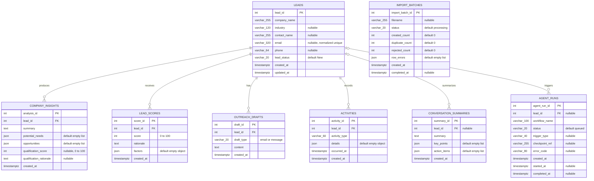

# SalesGenie detailed database ER diagram

This Mermaid diagram shows the tables, columns, SQL types, nullability, keys, and relationships from the initial Alembic migration.

`import_batches` has no direct foreign-key relationship to `leads`: it records a
CSV import's status, counts, and row errors; successfully imported records are
stored in `leads`. A lead can have zero or many related records. Insights,
scores, outreach drafts, and activities are deleted with a lead. Conversation
summaries and agent-run records remain, with `lead_id` set to `NULL`.

The model and migration define the database constraints in
`alembic/versions/0001_initial_schema.py`. The requester reports team approval
of the selected lifecycle values and duplicate-matching policy; formal
requirements/API sign-off remains pending.
